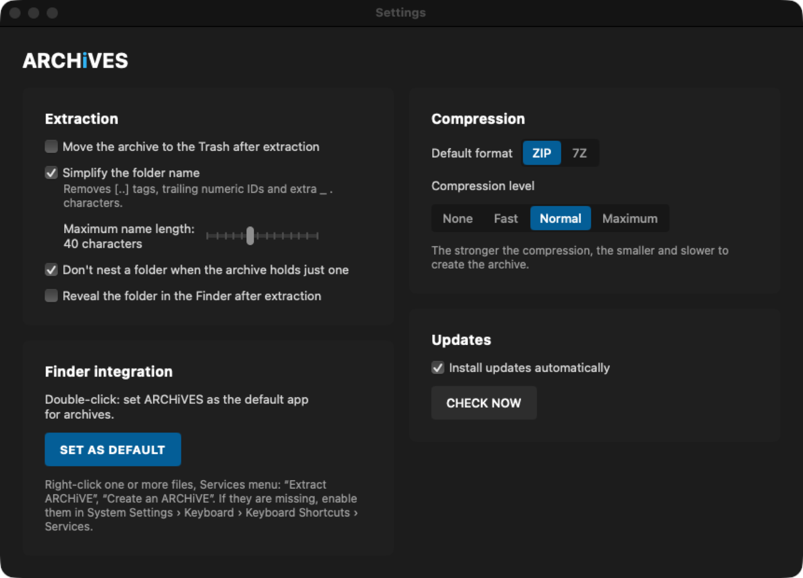

# ARCHiVES

Lightweight archive extraction and compression for macOS, built into the Finder.

## About

ARCHiVES is made by Starbudweiser & Claude Code (Anthropic). Part of the **DESKTOP MAC TOOLKIT**. MIT License, © 2026 Starbudweiser. Provided as is, without warranty. "About ARCHiVES" is in the app menu.

ARCHiVES is a small app inspired by The Unarchiver, with no link to its authors.



## What it does

- Double-click an archive (ZIP, RAR, 7z, TAR, GZ, BZ2, XZ…) and it is extracted into a folder named after the file, next to it.
- Finder Services (right-click › Services): "Extract ARCHiVE", "Create an ARCHiVE", "Create a protected ARCHiVE…".
- Password-protected archives: ZIP, 7z and RAR for extraction; ZIP and 7z for creation.
- Adjustable compression level (none, fast, normal, maximum).
- Interface in French, English, Spanish and Italian, chosen from the system language.
- Automatic updates from GitHub Releases (signature checked), with a manual update button in the settings.

RAR creation is not possible (proprietary format).

## Requirements

- macOS 15 or later, Apple Silicon.

## Installation

Download the latest `ARCHiVES-<version>-macOS-arm64.zip` from the [Releases](https://github.com/starbudweiser/ARCHiVES/releases) page, unzip it and move `ARCHiVES.app` to your Applications folder. The app is signed with a Developer ID and notarized by Apple.

## Build

```bash
brew install sevenzip   # 7zz is embedded in the app (passwords, RAR fallback)
./build_app.sh          # tests, build, signature, install in ~/Applications/Applications Personnelles
```

Engine: system `libarchive` (no password) and an embedded `7zz` (passwords, RAR fallback).

## License

MIT, see [LICENSE](LICENSE).

## Support / Soutenir

This app is free. If it is useful to you, you can support the project (optional, no reward expected): [GitHub Sponsors](https://github.com/sponsors/starbudweiser).

Cette appli est gratuite. Si elle vous est utile, vous pouvez soutenir le projet (facultatif, sans contrepartie) : [GitHub Sponsors](https://github.com/sponsors/starbudweiser).
